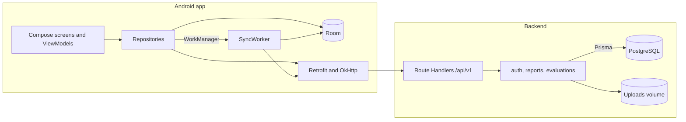

# Field Monitoring & Evaluation

[](https://github.com/inisialkey/field-monitoring/actions/workflows/ci.yml)

An offline-first Android app with a backend for monitoring and evaluating environmental programs funded by BPDLH (Badan Pengelola Dana Lingkungan Hidup, the Indonesian Environment Fund), such as mangrove planting, forest rehabilitation, and peatland restoration. Field Officers visit program sites and submit reports with photos and a location, with or without a connection, since many sites have no signal. Evaluators review the reports and mark them valid or invalid. The app's interface is in Indonesian.

- **Android:** Kotlin, Jetpack Compose, Material 3, Hilt, Room, WorkManager, Retrofit, OkHttp, Coil
- **Backend:** Next.js Route Handlers, TypeScript, Prisma, PostgreSQL, Zod, JWT
- **Tests:** JUnit and MockK on Android; Vitest against a real PostgreSQL database on the backend

## Features

**Field Officer**

- Signs in once while online. The session stays on the device until logout, so the app keeps working offline.
- Creates a report from photos (camera or gallery), the GPS location with its place name or a written location note, one of eight BPDLH program categories, a title, a description, and the observation time. Drafts are saved automatically.
- Submitted reports are sent in the background and retried when the connection comes back. Each report shows its status, including photo upload progress.
- Sees the evaluation result after the next sync.
- Can delete a draft, or a report the server has not accepted, after confirming.

**Evaluator**

- Reviews submitted reports online, oldest first, with full-screen photos and a map link.
- Marks each report Valid or Invalid. Notes are required for Invalid. The next report opens after sending.

## Quick start

You need Docker and `adb` (from Android SDK Platform-Tools), plus an Android Emulator or a phone running Android 8.0 or later.

**1. Start the backend.** From the repository root:

```bash
cp .env.example .env
docker compose up -d --build
```

The first build takes a few minutes. On start, the container applies the database migrations and creates the demo accounts. The API is ready when this answers `401 Unauthorized`:

```bash
curl -i http://localhost:3000/api/v1/me/reports
```

**2. Install the app.** Download an APK from the [latest release](https://github.com/inisialkey/field-monitoring/releases/latest). Both files are the same app and differ only in the backend address.

- On the Android Emulator, use the `emulator` APK. It connects to `http://10.0.2.2:3000`, the host machine as seen from the emulator.

  ```bash
  adb install field-monitoring-1.0.1-emulator.apk
  ```

- On a phone connected over USB with USB debugging on, use the `usb` APK. It connects to `http://localhost:3000`, which `adb reverse` forwards to your computer. Run `adb reverse` again whenever you reconnect the cable.

  ```bash
  adb install field-monitoring-1.0.1-usb.apk
  adb reverse tcp:3000 tcp:3000
  ```

**3. Sign in** with a demo account. Every account uses the password `demo12345`, set by `SEED_PASSWORD` in `.env`.

| Username | Role |
|----------|------|
| `rina` | Field Officer |
| `dedi` | Field Officer |
| `andi` | Evaluator |
| `maya` | Evaluator |

To stop the backend, run `docker compose down`. Add `-v` to also delete all reports and photos; the demo accounts are created again on the next start.

## Try it

1. Sign in as `rina`, then turn on airplane mode.
2. Tap **Buat laporan**, add a photo, get the location (or type a location note), pick a category, fill in the title and description, and tap **Kirim laporan**. The report waits with the status **Menunggu dikirim**.
3. Close the app from Recents and open it again. The report and its photo are still there.
4. Turn airplane mode off. The report is sent on its own, shows the upload progress, and ends as **Terkirim** and **Menunggu evaluasi**.
5. Sign out from the avatar menu and sign in as `andi`. Open the report from **Menunggu Evaluasi**, choose **Valid** or **Tidak valid**, and tap **Kirim evaluasi**.
6. Sign in as `rina` again and pull the list down to refresh. The report now shows the evaluation result.
7. To see how accounts are kept apart, save a draft as `rina` and sign out. The draft does not appear for `dedi`, and comes back when `rina` signs in again.

On the emulator, use a system image with Google Play, since location and place names rely on Google Play services. The emulator reports the location set under **Extended controls → Location**, and its camera shows a virtual scene.

## Build from source

Building the app needs JDK 17 or later and the Android SDK with platform 37 (Android Studio can install it). Open `android/` in Android Studio and run the `app` configuration, or start an emulator and run:

```bash
cd android
./gradlew installDebug
```

This build connects to `http://10.0.2.2:3000/`. For a phone on the same Wi-Fi network as your computer, pass the computer's address. The app allows unencrypted HTTP only for that host.

```bash
./gradlew installDebug -PapiBaseUrl=http://192.168.1.10:3000/
```

## Tests

The backend tests need Node.js 22 and run against the `field_monitoring_test` database that the `db` container creates:

```bash
docker compose up -d db
cd backend
npm ci
npm test
```

The Android unit tests run on the JVM:

```bash
cd android
./gradlew testDebugUnitTest
```

- **Backend:** idempotent report creation, owner mismatch, finalize with missing photos, single and concurrent second evaluations, the evaluation queue category filter and its paging, refresh token rotation and concurrent refresh, revoked accounts, logout, input validation, and the OpenAPI contract.
- **Android:** report rules, how server responses change the sync status, the owner check on outgoing requests, single-flight token refresh, and the evaluation queue category filter.

Linters keep the code style consistent: `npm run lint` in `backend` runs ESLint with typescript-eslint, and `./gradlew spotlessCheck lintDebug` in `android` runs ktlint and Android Lint. `./gradlew spotlessApply` fixes Kotlin formatting.

GitHub Actions runs the linters and both test suites, and builds the app, on every push and pull request to `main`. Pushing a version tag such as `v1.0.2` publishes signed APKs to Releases.

## Architecture



```
android/   Android app, one Gradle module
backend/   API, Prisma schema and migrations, integration tests
docker-compose.yml
```

The design uses domain-driven design where it pays off. Android and the backend share three bounded contexts: Identity (`auth`), Reporting (`report`), and Evaluation (`evaluation`). Synchronization is infrastructure, not a context, and lives in `sync`, with shared code in `core`. Inside each feature, `domain` holds plain Kotlin models and rules with no Android dependencies, `data` holds Room, Retrofit, and repositories, and `ui` holds Compose screens and ViewModels.

The `Report` aggregate guards its own rules: it validates itself, only a valid draft can be submitted, and only reports the server has not accepted can be deleted. The repository submits through the aggregate, so an invalid report never reaches the sync queue. Repositories are concrete classes, and there is no separate use-case layer, because each would have only one implementation. On the backend, Route Handlers only parse requests and format responses; the rules live in `src/modules`.

### Sending a report

For Field Officers, Room is the source of truth. Submitting locks the report and queues it. `SyncWorker` then sends it in three steps, each safe to repeat:

1. `PUT /reports/{id}` creates the report. The ID is a UUID generated on the device, so a retry never creates a duplicate.
2. `PUT /reports/{id}/attachments/{attachmentId}` uploads each photo that is not on the server yet.
3. `POST /reports/{id}/finalize` makes the report visible to Evaluators once every photo is stored. If one is missing, the server answers 409 with its ID, and the worker uploads it again.

| Server response | What the app does |
|-----------------|-------------------|
| Network error, timeout, 429, or 5xx | Retries with exponential backoff and marks the report failed after five attempts |
| 401 | Refreshes the token and retries once. If the refresh is rejected, sync pauses until the user signs in again |
| 400 or 422 | Returns the report to draft with the reason |
| 403 | Marks the report as needing attention and stops retrying it |

After sending, the worker downloads the user's reports to pick up evaluation results.

## Key decisions

- **Offline session.** Access tokens last 5 minutes. Refresh tokens rotate on every use, expire after 30 days without use, and are issued per device. The app keeps the session, encrypted with an Android Keystore key, until logout. Token refresh is single-flight, so a rotated refresh token is never sent twice.
- **Data stays with its owner.** Every local query is filtered by the signed-in user. Sync requests carry the report owner, and the HTTP layer refuses to send them under another account. Logout keeps unsent reports and drafts for when the same user signs in again, and deletes what is already on the server.
- **One final evaluation.** The database allows one evaluation per report. A second Evaluator gets 409 and sees the existing result.
- **Evaluators work online.** They review from the office, so their screens read from the server instead of keeping a local copy.
- **Photos.** The app resizes photos to 1920 px at JPEG quality 80 (2 MB at most). The server checks the file type from the file's bytes and serves photos only to the report owner and Evaluators.

## API

The full contract, with request and response schemas and every error code, is in [`backend/openapi.yaml`](backend/openapi.yaml) (OpenAPI 3.1). Import it into Postman or Insomnia, or open it in [Swagger Editor](https://editor.swagger.io/), to try the endpoints. A contract test checks that the file covers every endpoint and matches real responses.

Base path `/api/v1`. Errors have the shape `{ "code": "...", "message": "...", "details": [] }`.

| Method | Path | Allowed for | Purpose |
|--------|------|-------------|---------|
| POST | `/auth/login` | Anyone | Sign in and receive tokens and the profile |
| POST | `/auth/refresh` | Holder of a refresh token | Rotate the tokens |
| POST | `/auth/logout` | Holder of a refresh token | Revoke the refresh token |
| GET | `/me/reports` | Field Officer | Own reports with evaluation results |
| PUT | `/reports/{id}` | Field Officer | Create a report |
| PUT | `/reports/{id}/attachments/{attachmentId}` | Field Officer | Upload a photo |
| POST | `/reports/{id}/finalize` | Field Officer | Mark the report complete |
| GET | `/evaluations/queue` | Evaluator | Reports waiting for evaluation, oldest first, optionally filtered by `category` |
| GET | `/reports/{id}` | Owner or Evaluator | Report detail |
| POST | `/reports/{id}/evaluation` | Evaluator | Submit the evaluation |
| GET | `/attachments/{id}/content` | Owner or Evaluator | Download a photo |
