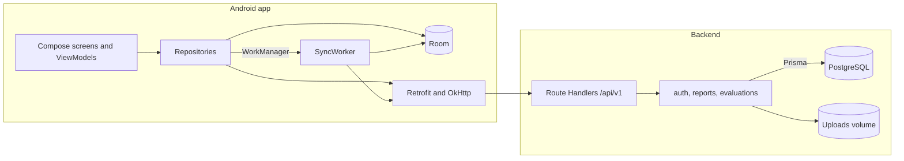

# Field Monitoring & Evaluation

An offline-first Android app with a backend for monitoring and evaluating environmental programs funded by BPDLH (Badan Pengelola Dana Lingkungan Hidup, the Indonesian Environment Fund), such as mangrove planting, forest rehabilitation, and peatland restoration. Field Officers visit program sites and submit reports with photos and a location, with or without a connection, since many sites have no signal. Evaluators review submitted reports and mark them valid or invalid. The app's interface is in Indonesian.

- **Android:** Kotlin, Jetpack Compose, Material 3, Hilt, Room, WorkManager, Retrofit, OkHttp, Coil
- **Backend:** Next.js Route Handlers, TypeScript, Prisma, PostgreSQL, Zod, JWT
- **Tests:** JUnit and MockK on Android; Vitest against a real PostgreSQL database on the backend

## Features

**Field Officer**

- Signs in once while online. The session stays on the device until logout, so the app keeps working offline.
- Creates a report starting from photos (camera or gallery), then the GPS location (with its place name, looked up when online) or a written location note, program category, title, description, and observation time. Drafts are saved automatically.
- Chooses from BPDLH program categories: forest and land rehabilitation, mangrove, peatland restoration, social forestry, renewable energy, waste management, biodiversity, and other.
- Submitted reports are sent in the background and retried when the connection comes back. Every report shows its status: draft, waiting, sending (with photo progress), sent, failed, or needs attention.
- Sees the evaluation result on the report after the next sync.
- Can delete a draft, or a report the server has not accepted (failed or needing attention), after confirming.

**Evaluator**

- Works from an online queue of submitted reports, oldest first.
- Opens a report with full-screen photos and a map link, then marks it Valid or Invalid. Notes are required for Invalid. The next report opens after sending.

## Getting started

You need Docker, JDK 17 or later, and the Android SDK with platform 37 (Android Studio can install it). Node.js 22 is only needed to run the backend tests.

### Backend

```bash
cp .env.example .env
```

Set `JWT_SECRET` in `.env` to a long random value, for example the output of `openssl rand -base64 48`. Then start the database and the API:

```bash
docker compose up -d --build
```

The API runs at `http://localhost:3000/api/v1`. On start, the container applies the migrations and creates the demo accounts.

### Demo accounts

| Username | Role | Password |
|----------|------|----------|
| `rina` | Field Officer | `demo12345` |
| `dedi` | Field Officer | `demo12345` |
| `andi` | Evaluator | `demo12345` |
| `maya` | Evaluator | `demo12345` |

The password comes from `SEED_PASSWORD` in `.env`.

### Android

The app runs on Android 8.0 (API 26) and later. Open `android/` in Android Studio and run the `app` configuration, or start an emulator and run:

```bash
cd android
./gradlew installDebug
```

The app talks to `http://10.0.2.2:3000/`, which is the host machine as seen from the emulator. For a physical device on the same network, pass the computer's address:

```bash
./gradlew installDebug -PapiBaseUrl=http://192.168.1.10:3000/
```

Cleartext HTTP is allowed only for the host in `apiBaseUrl`. `./gradlew assembleRelease` builds a minified APK signed with the debug key, for demos.

### Tests

```bash
docker compose up -d db
cd backend
npm ci
npm test
```

The backend tests run against the `field_monitoring_test` database that the `db` container creates. Set `TEST_DATABASE_URL` if you changed the database credentials.

```bash
cd android
./gradlew testDebugUnitTest
```

- **Backend:** idempotent report creation, owner mismatch, finalize with missing photos, single and concurrent second evaluations, refresh token rotation and concurrent refresh, revoked accounts, logout, and input validation.
- **Android:** submit validation rules, how server responses change the sync status, the owner check on outgoing requests, and single-flight token refresh.

## Architecture



```
android/   Android app, one Gradle module
backend/   API, Prisma schema and migrations, integration tests
docker-compose.yml
```

The Android code is grouped by feature (`auth`, `report`, `evaluation`, `sync`) with shared code in `core`. Inside each feature, `domain` holds plain Kotlin models and rules, `data` holds Room, Retrofit, and repositories, and `ui` holds Compose screens and ViewModels. On the backend, Route Handlers only parse requests and format responses; the rules live in `src/modules`.

### Sending a report

For Field Officers, Room is the source of truth. Submitting locks the report and queues it. `SyncWorker` then sends it in three steps, each safe to repeat:

1. `PUT /reports/{id}` creates the report. The ID is a UUID generated on the device, so a retry never creates a duplicate.
2. `PUT /reports/{id}/attachments/{attachmentId}` uploads each photo that is not on the server yet.
3. `POST /reports/{id}/finalize` makes the report visible to Evaluators once every photo is stored. If one is missing, the server answers 409 with its ID, and the worker uploads it again.

| Server response | What the app does |
|-----------------|-------------------|
| Network error, timeout, 429, or 5xx | Retries with exponential backoff and marks the report failed after five attempts |
| 401 | Refreshes the token and retries once. If the refresh is rejected, sync pauses until the user signs in again |
| 400 or 422 | Returns the report to draft with the reason |
| 403 | Marks the report as needing attention and stops retrying it |

After sending, the worker downloads the user's reports to pick up evaluation results.

## Key decisions

- **Offline session.** Access tokens last 5 minutes. Refresh tokens rotate on every use, expire after 30 days without use, and are issued per device. The app keeps the session, encrypted with an Android Keystore key, until logout. Token refresh is single-flight, so a rotated refresh token is never sent twice.
- **Data stays with its owner.** Every local query is filtered by the signed-in user. Sync requests carry the report owner, and the HTTP layer refuses to send them under another account. Logout keeps unsent reports and drafts for when the same user signs in again, and deletes what is already on the server.
- **One final evaluation.** The database allows one evaluation per report. A second Evaluator gets 409 and sees the existing result.
- **Evaluators work online.** They review from the office, so their screens read from the server instead of keeping a local copy.
- **Photos.** The app resizes photos to 1920 px at JPEG quality 80 (2 MB at most). The server checks the file type from the file's bytes and serves photos only to the report owner and Evaluators.

## API

Base path `/api/v1`. Errors have the shape `{ "code": "...", "message": "...", "details": [] }`.

| Method | Path | Allowed for | Purpose |
|--------|------|-------------|---------|
| POST | `/auth/login` | Anyone | Sign in and receive tokens and the profile |
| POST | `/auth/refresh` | Holder of a refresh token | Rotate the tokens |
| POST | `/auth/logout` | Holder of a refresh token | Revoke the refresh token |
| GET | `/me/reports` | Field Officer | Own reports with evaluation results |
| PUT | `/reports/{id}` | Field Officer | Create a report |
| PUT | `/reports/{id}/attachments/{attachmentId}` | Field Officer | Upload a photo |
| POST | `/reports/{id}/finalize` | Field Officer | Mark the report complete |
| GET | `/evaluations/queue` | Evaluator | Reports waiting for evaluation, oldest first |
| GET | `/reports/{id}` | Owner or Evaluator | Report detail |
| POST | `/reports/{id}/evaluation` | Evaluator | Submit the evaluation |
| GET | `/attachments/{id}/content` | Owner or Evaluator | Download a photo |

## Limitations

- There is no app lock on cold start; the app relies on the device screen lock.
- Reports accept photos only, not PDF documents.
- Users come from the seed script. There is no admin screen or CLI for changing roles or revoking accounts.
- Access tokens are not checked against the database, so revoking an account or changing a role takes effect when the current token expires, within 5 minutes.
- Reuse of an old refresh token is rejected but not treated as a sign of theft.
- Accounts sharing a device are separated by the app, not by per-account encryption. Unsent data of an account that can no longer sign in can only be removed by clearing the app's storage.
- Each sync downloads all of the user's reports instead of only the changes.
- Each photo uploads in one request; there is no resumable upload.
- Uploaded files are stored on a local Docker volume.

## Credits

Icons are [Material Symbols](https://fonts.google.com/icons) by Google, under the Apache License 2.0.
